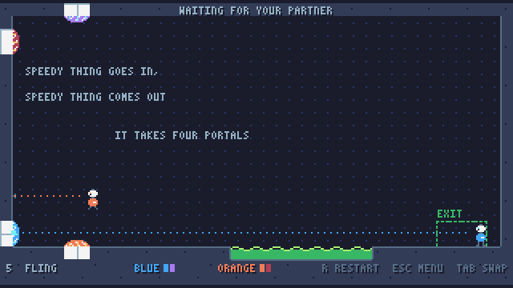

# Portal Pals

A co-op 2D portal platformer for two robots on one screen, in LÖVE. It's an MVP
in the spirit of Portal 2's co-op: each robot has its own pair of portals,
either robot can use either pair, and the six test chambers are built so the
two of you have to work together.

```sh
love .              # LÖVE 11.x
love . 5            # dev: straight into chamber 5
love . --shots      # dev: plays each chamber's scripted solution part way and
                    # writes screenshots to the save directory's shots/
luajit tests/run.lua    # the tests, no LÖVE needed
```



## Controls

Both robots play on one keyboard, or with gamepads, or a mix.

| | Blue (left hand) | Orange (right hand) | Gamepad |
|---|---|---|---|
| move | A / D | ← / → | left stick, d-pad |
| aim | WASD (8 ways), or the mouse | arrows (8 ways) | right stick (or the left) |
| jump | Space | `/` (or numpad 0, right Ctrl) | A |
| portal 1 / 2 | Q / E, or left / right click | `,` / `.` (or numpad 1 / 2) | LB / RB (or triggers) |
| grab / drop a cube | F, or middle click | `;` (or numpad 3) | X or B |

With one gamepad it plays Orange; with two, one each. **Tab** (or a pad's Back)
swaps which robot the two keyboard halves drive, so one person can play both
robots alone, slowly. **R** restarts the chamber, **Esc** goes back to the
chamber list, **F11** toggles fullscreen, **M** mutes.

With no direction held, a robot aims the way it faces. The dashed line from
its gun shows where a shot will land, ending in a lit square if a portal fits
there and a grey X if it doesn't.

## How it plays

- **Portals** go on white panels only, two tiles long, with open air in front.
  Metal, doors and the edges of things refuse them. A robot's two portals lead
  only to each other; a pair works once both ends are placed. Blue's are blue
  and violet, Orange's orange and red.
- **Anything goes through any pair.** Robots and cubes both, and Orange can use
  Blue's portals as easily as its own. That's most of the co-op.
- **Speed in is speed out.** A body that falls 15 tiles into a floor portal
  comes out of a wall portal moving sideways at that speed. In the air you can
  steer up to a run, or against a fling, but nothing slows a fling you're going
  along with.
- **Robots are platforms.** Land on your partner's head and you ride it; jump
  from there and you reach a ledge one robot can't. A jump clears three tiles,
  not four. A four-tile step is the "boost me up" step.
- **Buttons** hold a door open while a robot or a cube stands on them. A door
  normally opens on any of its buttons; some want every button at once.
- **Cubes** are picked up, carried through portals, thrown (they keep the
  robot's speed), and set down on buttons.
- **Emancipation grills** wipe the portals of a robot that walks through them,
  and dissolve a carried cube, which comes back to its dropper.
- **Goo** kills a robot (it reappears where it started, portals intact) and
  dissolves a cube.
- **The exit** needs both robots inside it at once.

## The chambers

1. **PORTALS 101**: two white walls with goo between them. One portal on
   each wall and walk in.
2. **HOLD THE DOOR**: one robot holds the door for the other, which holds it
   back from the far side.
3. **BOOST**: a four-tile step. One robot climbs its partner's head, then
   stands on the button that opens the way round for it.
4. **CUBE**: carry the cube through a wall portal, out of the ceiling, onto
   the button.
5. **FLING**: four portals. Walk into Blue's pair, drop the height of the room
   from the ceiling into Orange's floor portal, and come out of the high wall
   flying across the goo.
6. **TOGETHER**: two buttons that must both be held, two cubes, and one of
   them up a step only a boost reaches.

Progress (the furthest chamber opened) is saved to `progress.txt` in LÖVE's
save directory, under `portal-coop/`.

## How it's built

The rules (`src/world.lua`) are plain Lua with no LÖVE calls in them, stepped at
a fixed 120Hz. That buys two things. A fling goes the same distance on every
machine whatever the frame rate. And the whole game runs headless, so
`tests/levels_test.lua` plays every chamber from spawn to exit with scripted
inputs. A change to the physics or a map that makes a chamber unsolvable as
designed fails a test rather than a playtest.

| File | What it is |
|---|---|
| `main.lua` | window, the low-res canvas, the whole-number zoom |
| `src/game.lua` | the screens (title, play, end), the fixed step, events → sounds and sparks, progress |
| `src/world.lua` | the rules: tiles, robots, cubes, portals, buttons, doors, the exit |
| `src/levels.lua` | the six chambers, as 40x22 ASCII maps |
| `src/defs.lua` | every number the rules use |
| `src/input.lua` | keyboard halves, mouse and gamepads → per-robot input |
| `src/draw.lua` | paints a world, a whole pixel at a time |
| `src/sprites.lua` | the robots and the cube, as ASCII art |
| `src/palette.lua`, `src/font.lua` | the colours, and a 3x5 pixel face |
| `src/sfx.lua` | every sound, synthesised at load. No sample files |
| `src/shots.lua` | dev: `--shots` |
| `tests/` | `run.lua`, the mechanics tests, the chamber playthroughs and their driver |

### Rendering

Everything draws into a canvas of game pixels, scaled up by the largest whole
number that fits the 320x176 chamber in the window. Sprites are ASCII grids of
palette keys, lines are Bresenham-plotted, and nothing rotates. A robot facing
left is its sprite mirrored. These are the habits of the sibling Survive
School and Mycelio TD projects, carried over.

### Portals, exactly

A portal sits on one face of a tile: a normal pointing into the room, and a
tangent that is fixed per orientation (down for walls, right for floors and
ceilings) rather than turned with the normal. That choice means wall-to-wall
travel keeps which way is up and floor-to-floor keeps which way is forward,
which is what a player expects in 2D. A body teleports on the step where its
leading edge crosses a linked portal's face with its middle inside the
opening. Its speed into the face becomes speed out of the other (at least
`EXIT_MIN`, so nothing sits stuck in an opening), its sideways speed carries
over along the tangent, and it's placed just clear of the far face. If the far
side has no room, the portal behaves as a wall.

Movement resolves one axis at a time in steps of at most 3px, so nothing tunnels
through a one-tile wall even at fling speed, and the portals get first look
before each axis meets the tiles.

### Adding a chamber

Add a map to `src/levels.lua` (the legend is at the top of `src/world.lua`)
and a solution to `tests/levels_test.lua`. The test fails until the chamber
can be played through as you meant it, and `love . --shots` shows it.

## Not in the MVP

Online play, a level editor, light bridges, lasers, gels, moving platforms,
and portals seen through portals.
